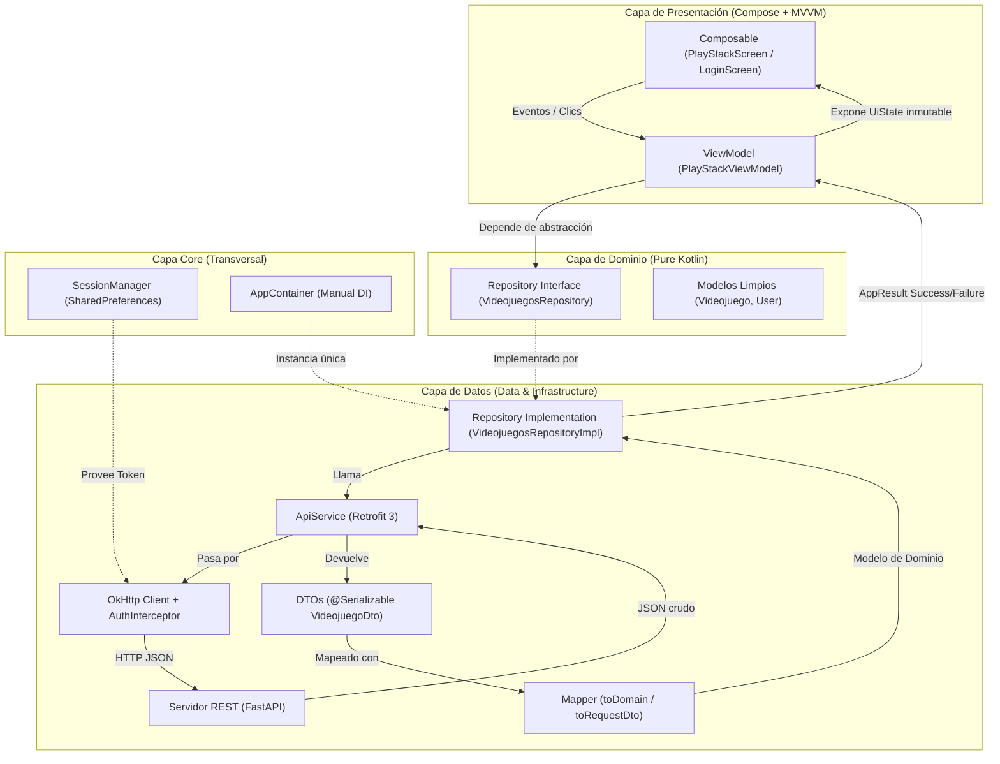
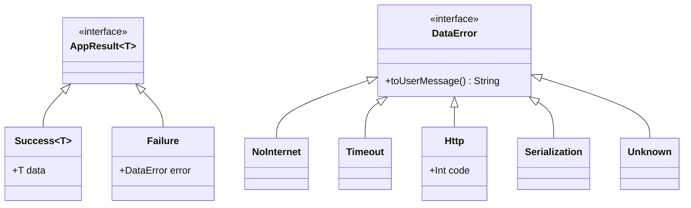
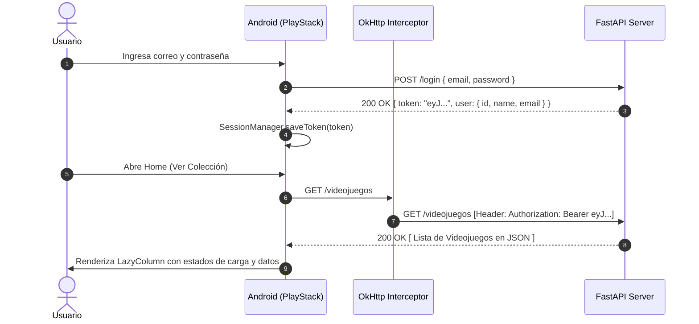
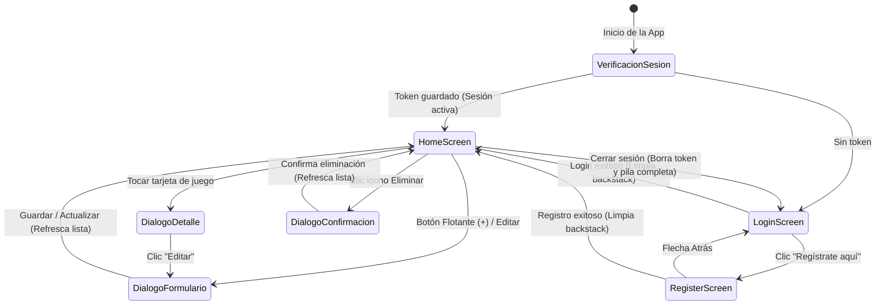

# UNIVERSIDAD POLITÉCNICA DE CHIAPAS
**Ingeniería en Desarrollo y Gestión de Software**  
**Asignatura:** Desarrollo de Aplicaciones Móviles · Android Nativo  
**Docente:** Dr. Alí López  
**Alumno:** Emmanuel Salazar Gumeta  
**Matrícula:** 253448  
**Fecha de Entrega:** 09 de Noviembre de 2026  

---

# REPORTE TÉCNICO: PROYECTO INTEGRADOR UNIDAD 3
## **PlayStack: Aplicación Móvil CRUD con Autenticación JWT y Clean Architecture**

---

## 1. Resumen Ejecutivo y Propósito
El presente proyecto integrador consiste en el diseño, desarrollo e implementación de una solución móvil nativa para Android denominada **PlayStack**. La aplicación resuelve la gestión integral (CRUD) de una colección personal de videojuegos respaldada por autenticación segura basada en tokens JWT.

El diseño sigue estrictamente los principios de **Clean Architecture**, el patrón arquitectónico **Model-View-ViewModel (MVVM)** con **Jetpack Compose (Material 3)**, manejo reactivo de estado con **StateFlow**, persistencia desacoplada y consumo de una API REST mediante **Retrofit 3**, **OkHttp (con interceptor de autenticación)** y **kotlinx.serialization**, cumpliendo con una **inyección de dependencias 100% manual** sin uso de frameworks externos como Hilt, Koin o Dagger.

---

## 2. Definición del Dominio: Colección de Videojuegos
El dominio seleccionado corresponde al catálogo de videojuegos personales. Cumple con los requerimientos estipulados de contar con un identificador único y más de 5 atributos propios que combinan datos numéricos, booleanos y de texto, acompañados de reglas de validación en la capa de presentación.

### Modelo del Recurso Principal: `Videojuego`
| Atributo | Tipo Kotlin | Tipo JSON | Regla de Validación / Requisito | Propósito en el Dominio |
| :--- | :--- | :--- | :--- | :--- |
| `id` | `Int` | `number` | Autonumérico único generado por el backend | Identificador principal |
| `titulo` | `String` | `string` | Obligatorio, longitud mínima de 3 caracteres | Nombre del título |
| `plataforma` | `String` | `string` | Obligatorio, no vacío (PC, Switch, PS5, Xbox) | Sistema o consola |
| `precio` | `Double` | `number` | Numérico decimal, $\ge 0.0$ | Valor de adquisición en USD |
| `horasJugadas` | `Int` | `number` | Numérico entero, $\ge 0$ | Tiempo dedicado acumulado |
| `completado` | `Boolean` | `boolean` | Booleano (`true` / `false`) | Estado de avance de la campaña |
| `genero` | `String` | `string` | Texto descriptivo (RPG, Acción, Aventura...) | Categorización temática |

---

## 3. Arquitectura del Sistema: Clean Architecture + MVVM

La arquitectura desacopla completamente las responsabilidades del sistema en capas unidireccionales, garantizando que los cambios en infraestructura o red no impacten las reglas de negocio ni la interfaz de usuario.

### 3.1 Flujo de Información de Extremo a Extremo


### 3.2 Desglose de Capas y Responsabilidades
1. **Dominio (`domain`):** Código Kotlin puro sin referencias a librerías de Android o Retrofit. Alberga los modelos de datos y las interfaces de repositorio (`VideojuegosRepository`, `AuthRepository`).
2. **Datos (`data`):** Contiene la implementación concreta del repositorio, las definiciones de contratos de Retrofit (`VideojuegosApiService`), los objetos de transferencia de red (`VideojuegoDto`) marcados con `@Serializable` y los **Mappers** de extensión para traducir DTOs a modelos de dominio limpios.
3. **Presentación (`presentation`):** Desarrollada 100% en **Jetpack Compose** con Material 3. Los composables son libres de lógica; únicamente observan estados inmutables (`UiState`) a través de `collectAsStateWithLifecycle()` y delegan acciones al ViewModel mediante eventos/lambdas.
4. **Core (`core`):** Módulos transversales que gestionan el contenedor de inyección (`AppContainer`), el almacenamiento de credenciales (`SessionManager`), el interceptor HTTP de autorización (`AuthInterceptor`) y el manejo de errores tipados (`AppResult` y `DataError`).

---

## 4. Capa de Red y Autenticación Segura

### 4.1 Token JWT y OkHttp AuthInterceptor
Para cumplir con el principio **DRY (Don't Repeat Yourself)**, se implementó un `AuthInterceptor` en la cadena de conexión de OkHttp. De esta manera, cada solicitud HTTP dirigida al backend obtiene automáticamente el encabezado estándar sin necesidad de anotar manualmente cada endpoint:
$$\text{Authorization: Bearer } <\text{token\_jwt}>$$

```kotlin
class AuthInterceptor(
    private val sessionManager: SessionManager
) : Interceptor {
    override fun intercept(chain: Interceptor.Chain): Response {
        val token = sessionManager.getToken()
        val request = chain.request().newBuilder().apply {
            if (!token.isNullOrBlank()) {
                header("Authorization", "Bearer $token")
            }
        }.build()
        return chain.proceed(request)
    }
}
```

### 4.2 Manejo Robusto de Errores Tipados (`AppResult` y `safeApiCall`)
En lugar de propagar excepciones en tiempo de ejecución (`IOException`, `HttpException`, `SocketTimeoutException`), las llamadas de red se capturan de forma segura y se convierten en estados tipados:



> **Regla de Corrutinas aplicada:** En la función de orden superior `safeApiCall`, la excepción `CancellationException` **nunca se oculta**, sino que se relanza inmediatamente para preservar el ciclo de vida de la concurrencia estructurada en Kotlin.

---

## 5. Inyección de Dependencias Manual

Para apegarse a la directriz académica de evitar frameworks de inyección automatizada (Hilt, Koin o Dagger), se diseñó un contenedor manual de dependencias centralizado:

1. **`AppContainer`:** Define las instancias compartidas del sistema.
2. **`DefaultAppContainer`:** Implementa la construcción perezosa (`by lazy`) de `OkHttpClient`, `Json`, `Retrofit`, `SessionManager` y los repositorios (`AuthRepositoryImpl` y `VideojuegosRepositoryImpl`).
3. **`KtApplication`:** Extiende de `Application` de Android y mantiene viva la instancia de `AppContainer` a lo largo de todo el ciclo de vida del proceso.
4. **`ViewModelProvider.Factory`:** Los ViewModels se inicializan usando `viewModelFactory { initializer { ... } }`, inyectando las dependencias requeridas exclusivamente como interfaces de dominio a través del constructor.

---

## 6. Especificación de la API REST (Backend FastAPI)

La aplicación se comunica con un backend desacoplado desarrollado en **FastAPI (Python)**, que garantiza respuestas estándar y persistencia estructurada.



### Tabla de Endpoints del Contrato REST
| Método | Ruta | Autorización | Descripción | Respuesta Exitosa | Códigos de Error |
| :--- | :--- | :--- | :--- | :--- | :--- |
| `POST` | `/register` | Pública | Registro de nuevo usuario | `201 Created` + JWT y datos | `400 Bad Request` (correo ya registrado) |
| `POST` | `/login` | Pública | Autenticación con credenciales | `200 OK` + JWT y datos | `401 Unauthorized` (credenciales incorrectas) |
| `GET` | `/videojuegos` | `Bearer Token` | Obtiene lista de juegos registrados | `200 OK` + `List<VideojuegoDto>` | `401 Unauthorized` |
| `GET` | `/videojuegos/{id}` | `Bearer Token` | Consulta el detalle de un juego | `200 OK` + `VideojuegoDto` | `401`, `404 Not Found` |
| `POST` | `/videojuegos` | `Bearer Token` | Registra un nuevo videojuego | `201 Created` + `VideojuegoDto` | `400`, `401 Unauthorized` |
| `PUT` | `/videojuegos/{id}` | `Bearer Token` | Actualiza atributos del juego | `200 OK` + `VideojuegoDto` | `401`, `404 Not Found` |
| `DELETE`| `/videojuegos/{id}` | `Bearer Token` | Elimina juego de la colección | `200 OK` + mensaje confirmación | `401`, `404 Not Found` |

---

## 7. Experiencia de Usuario y Ciclo de Navegación en Jetpack Compose

La navegación está construida con **Navigation Compose** a través de `AppNavHost`:



### Funcionalidades destacadas en la UI:
* **Formulario Reutilizable:** `VideojuegoFormDialog` se reutiliza tanto para la creación como para la edición precargada.
* **Manejo de Estados Visuales:** Estados nativos de Carga (`CircularProgressIndicator`), Lista Vacía (con ilustración e invitación a crear) y Estado de Error (con mensaje legible y botón de **Reintentar**).
* **Confirmación Destructiva:** Diálogo `AlertDialog` de advertencia antes de ejecutar cualquier eliminación permanente.
* **Protección de Salida:** El cierre de sesión purga el backstack de navegación (`popUpTo(0) { inclusive = true }`), impidiendo que el usuario vuelva a entrar mediante el botón "Atrás" del sistema.

---

## 8. Principios de Ingeniería Aplicados

* **S (Single Responsibility Principle):** Cada archivo y clase desempeña una función atómica (`VideojuegoMapper` solo convierte datos; `VideojuegosApiService` solo declara rutas HTTP; `VideojuegosViewModel` solo manipula estados de interfaz).
* **O (Open/Closed Principle):** La capa de red OkHttp se extiende mediante interceptores independientes sin alterar la lógica de negocio ni los repositorios.
* **L (Liskov Substitution Principle):** Cualquier repositorio puede ser reemplazado por un mock o implementación simulada (`FakeVideojuegosRepository`) sin que la UI o los ViewModels requieran modificación.
* **I (Interface Segregation Principle):** Interfaces de servicio divididas en contratos modulares (`AuthApiService` y `VideojuegosApiService`) en vez de una interfaz monolítica.
* **D (Dependency Inversion Principle):** El ViewModel interactúa exclusivamente contra la interfaz de abstracción (`VideojuegosRepository`), ignorando los detalles de implementación de `VideojuegosRepositoryImpl`.
* **KISS (Keep It Simple, Stupid):** Llamadas suspend directas sobre corrutinas sin capas intermedias innecesarias.
* **YAGNI (You Aren't Gonna Need It):** Un solo recurso principal enriquecido con 6 atributos, evitando complejidad relacional artificial que sobrecargue el sistema.
* **DRY (Don't Repeat Yourself):** Reutilización de componentes composables, mappers de datos centralizados y un único punto de inyección de cabeceras de autorización.

---

## 9. Conclusión
El proyecto **PlayStack** consolida exitosamente las competencias de desarrollo en Android moderno: arquitectura limpia, reactividad con corrutinas y StateFlow, inyección manual de dependencias y comunicación desacoplada mediante APIs REST. La solución ofrece un código mantenible, fácilmente testeable y preparado para entornos productivos reales.
